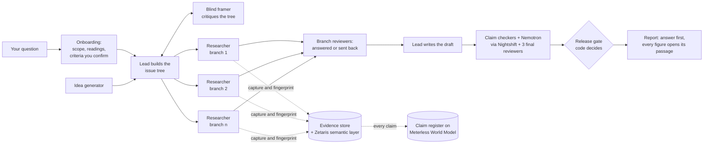

<div align="center">

# Descartes

### Consulting-grade research: every question broken into an issue tree, every number held to its source.

**Accept nothing you cannot verify. Divide every difficulty into parts.**<br>
<sub>René Descartes, *Discourse on the Method* (1637), paraphrased</sub>


**[Demo video](#demo)** · **[Quick start](#quick-start)** · **[How it works](#how-it-works)** · **[What you can ask](#what-you-can-ask)** · **[Verify it yourself](#verify-it-yourself)** · **[Sponsor technology](#sponsor-technology)** · **[Limits](#limits)**

</div>

> [!NOTE]
> Descartes is a hackathon prototype. Its checks run end to end, but no run has yet released an answer end to end, and no accuracy comparison with other research tools is claimed. See [Limits](#limits).

Descartes answers one hard business question the way a strong consulting team does. It frames the question, breaks it into an issue tree, gives each branch its own researcher and reviewer, and answers the question you asked, first. Every figure in the answer quotes its passage from a stored, fingerprinted copy of the source and is checked by an agent that did not write it. Code, not a model, decides whether the answer may be released, and you can re-check a finished run on your own machine, offline.

## Demo

Demo video: *link added at submission.* Slide deck: *link added at submission.*

Entry for the Open Agent Hackathon 2026, Track 02, "The Agent That Can Explain Why", by Jack Riddle.

## Quick start

**Requirements:** Python 3.12, Node (for the conformance suite), and for live runs the pinned Claude Code CLI (2.1.308) signed in on your machine. Zetaris and Meterless Nightshift are optional.

```bash
git clone https://github.com/riddlejack/descartes.git
cd descartes
python3.12 -m venv .venv && source .venv/bin/activate
pip install -e '.[evidence,server,register,driver,datalayer,providers,dev]'
```

**Check it without keys:**

```bash
python run.py conformance        # Meterless World Model's own conformance suite, run live against the claim register
pytest -q tests hackathon/tests  # the test suite
```

**Ask a question** (live; uses your Claude Code subscription, takes hours, and costs tens to hundreds of dollars of model use):

```bash
python run.py new "Should we enter the US pet-insurance market?"   # confirm the scope, the readings of ambiguous terms, and 3-5 criteria
python run.py ask "Should we enter the US pet-insurance market?"   # the run; add --as-of YYYY-MM-DD to freeze the web at a past date
python run.py status RUN_DIR                                         # what is running, what landed, what waits on you
python run.py report RUN_DIR OUT_DIR                                 # a static page: the answer first, every figure opens its passage
```

Copy `.env.example` and export its variables first. Zetaris (`STEMMA_DATALAYER=zetaris`, setup in [`hackathon/zetaris/README.md`](hackathon/zetaris/README.md)) and Nightshift (`METERLESS_BASE_URL`, `METERLESS_RUNTIME_TOKEN`) are optional. Every command is listed in [`hackathon/README.md`](hackathon/README.md).

> [!IMPORTANT]
> The project was called Stemma 2 while it was built. The Python package, its paths and its environment variables keep the name `stemma`.

## How it works



1. **You ask one question.** Onboarding drafts its type, each ambiguous term with its readings, and three to five plain criteria the answer must meet; you accept or edit each. By default only the question you asked is researched.
2. **It frames the question as an issue tree.** An idea generator lists what could matter. The lead builds a tree of short sub-questions; each level splits its parent by one analytical act (parts of a whole, causes of one effect, kinds of one thing), with no gaps or overlaps. A blind framer, holding none of the lead's instructions, frames the question on its own, then critiques the lead's tree; the lead answers every point.
3. **Each branch gets its own researcher.** Researchers capture web pages, SEC filings and market data and run calculations. A page can support a figure only once it is captured and fingerprinted (SHA-256). A separate branch reviewer decides whether each branch answered its sub-question, or sends it back. The lead reads no sources; it connects what the branches found.
4. **Every number is held to its source.** Each figure is a claim in the register, tied to an exact quotation; code checks the quotation is in the stored text and re-runs every calculation in a sandbox. A claim checker that did not write the claim reads the source and rules on it. NVIDIA Nemotron, through Meterless Nightshift, gives a second opinion from another model family. Three final reviewers read the draft: one as the person who asked, one working back from statements to sources, one for mechanical faults.
5. **Code decides release.** The gate refuses an untagged figure or one the checker found unsupported, shows a figure it could not check as "not checked", and refuses while a final review holds a material point. The report opens with the answer; what was not researched, and why, is stated at the end.

Ten roles in all. Each instruction a role reads names the failure it prevents and the evidence for it: [`docs/ROLE-MAP.md`](docs/ROLE-MAP.md).

## What you can ask

The kinds of question it is built for, with the first cut a consultant would make. Only the last tree is from a real Descartes run; the others illustrate the split. (Four question-type guides ship as skills: decision, market sizing, company evaluation and mechanism.)

| Kind of question | Example | First split of the tree |
|---|---|---|
| Decision | Should we enter the US pet-insurance market? | Market attractiveness · competitive landscape · our capabilities · financial returns *(illustrative)* |
| Market sizing | How many home EV chargers will US households install in 2030? | EV-owning households × share with a garage or driveway × share who install *(illustrative)* |
| Company evaluation | Can this company refinance the debt it owes by 2028? | How much falls due, when · cash it will generate · what lenders will offer, on what terms *(illustrative)* |
| Progress toward a target | Is the U.S. on track to reach 500,000 public EV charging ports by 2030? | Ports in service now · how fast net additions have grown · whether additions to 2030 run above or below that pace *(real run, below)* |

### A real tree

A framing run on 27 October 2026 (framing only: no branch was researched). Top two levels:

- **Is the U.S. public port count on course to reach 500,000 by end-2030?**
  - How many public charging ports are in service now?
  - Have yearly net additions of public ports been rising, and how fast? *(a crux: openings, removals, reclassifications)*
  - Will net additions from now to 2030 run above or below the recent pace? *(ports already funded or committed; builds not yet committed; time from award to opening; removals)*
  - What else in primary sources bears on the 2030 count? *(an open lane)*

The blind framer's critique changed it: the lead restated the root, cut the 2030 subtree from 27 live questions to 17, and named two cruxes. The questions it merged stay in the tree, marked set aside with the reason.

## Verify it yourself

You do not have to trust a report. On any recorded run, offline and with no keys:

| Command | What it does |
|---|---|
| `python run.py verify RUN_DIR` | Re-hashes every captured source, finds every quotation again in the stored text, re-runs every calculation, re-derives every claim id, and re-hashes every file the register fingerprinted. Names each failure; exit code 0 means all passed. |
| `python run.py tamper RUN_DIR` | Copies the run, changes one byte of the stored source behind a cited figure, verifies again and shows the release refused. The original is never touched. |
| `python run.py report RUN_DIR OUT_DIR` | Writes one static page (`index.html`) that GitHub Pages can serve. |
| `python run.py logs RUN_DIR` | The judge's log: the model behind each request, each World Model transaction, each Zetaris query with its row count, and the answer. |

`verify` is not a formality: on the first live run it found that 18 of 181 calculations no longer reproduced, because their scripts had been edited after their claims were filed ([`docs/notes/product-v2.md`](docs/notes/product-v2.md)).

## Sponsor technology

| | What Descartes uses it for | How to check it |
|---|---|---|
| **Zetaris** | The data layer. Each run's evidence tables (captures, claims, support, calculation inputs, entities, verdicts, SEC facts, table cells) are registered in a local Zetaris install as one Unified Semantic Layer per run. Every calculation's inputs are read back through it in SQL; a one-bit difference from the registered value is refused. A read-only `query_data` tool answers questions over the evidence. | `python run.py logs RUN_DIR` shows each query's SQL and row count. `tests/datalayer/test_live.py` reads every value back through Zetaris equal to the local copy, bit for bit. Setup: [`hackathon/zetaris/README.md`](hackathon/zetaris/README.md). |
| **Meterless World Model** (Engine) | The claim register's engine: a clean-room Python implementation of World Model's data model holds every claim, verdict, supersession and the issue tree. | `python run.py conformance` runs World Model's own conformance runner, unmodified: 8 of 8 checks pass, and three deliberate breakages each fail it. |
| **Meterless Nightshift + NVIDIA Nemotron** | A second model family on every quoted claim: Nemotron 3 Ultra (fallback Nemotron 3.5 Lightning) through Nightshift, beside Claude's verdict; a disagreement starts a fresh Claude checker. It never approves a claim and never lowers a check. | Every call writes a receipt naming the model that answered. On the first live run Nemotron agreed on 40 of 49 cited claims; the third look on the other 9 found no Claude error, and 7 were citations whose quoted span alone did not show the claim. |

<details>
<summary><b>How Descartes connects to Nightshift, and what does not run through it</b></summary>

`src/stemma/providers/nightshift.py` is a client for the Nightshift Runtime's OpenAI-compatible contract (0.90.0). It reads `METERLESS_BASE_URL` (default `http://127.0.0.1:8088/v1`) and `METERLESS_RUNTIME_TOKEN`, sends `meterless-app: stemma` on every request and `meterless-scope: user` on chat, checks status with `GET /v1/models`, and calls `POST /v1/chat/completions` with the Nemotron model named explicitly. Every call writes a receipt: the route asked for, the model the answer names, the `meterless-*` response headers, the request's digest and sizes, timing and usage. The token and the message text are never logged, and the client never falls back to another provider. The NVIDIA key lives only in Nightshift.

Descartes's research agents (the lead, researchers, framer, checkers and reviewers) run on Claude Opus 5.5 in Claude Code, on a Claude subscription. Inside a run, every model call the host makes itself goes through Nightshift; the agents' own calls do not. Running them through Nightshift needs a bridge from Claude Code's Anthropic Messages format to Nightshift's OpenAI-compatible one, billed at API rates through a key configured in Nightshift. That bridge is not built, so Nightshift is a working provider for one real feature, not yet the primary provider of the research calls.
</details>

## Where it can go

Descartes is wired for Claude Code today, because that is the subscription I pay for. Each row below is designed or planned, not built:

| Extension | What exists today | What is not built yet |
|---|---|---|
| Codex, Cursor and other harnesses | The evidence service and the register run as their own MCP server (`plugin/.mcp.json`), which both speak | Role identity rests on a Claude Code hook; a design for other harnesses is written |
| API models, or Nightshift end to end | Nightshift already carries the second-family check | Research roles on non-Claude models; the format bridge |
| Fully local (for example a DGX Spark) | `verify` needs no model and no network; frozen-web runs read archived sources | Research on local models (untested: no machine to test it on) |
| A company's own files | Attached files are captured, hashed, quoted and checked like web pages | Connectors to Drive, SharePoint and similar |
| A company's databases through Zetaris | Each run's evidence already lives in a Zetaris semantic layer | Capturing a company's own Zetaris query results as receipted evidence |
| Data sources such as PitchBook | Two worked examples of a source that issues receipts: SEC filings and market series | Any paid-database connector |
| Your own skills and playbooks | Four question-type guides ship as skills | Loading practice cards pinned by SHA-256 (on a branch, not merged) |

## Limits

- **No run has yet released an answer end to end, and no accuracy comparison is claimed.** The gate refusing an answer whose final review is still open is the design working; it also means there is no released answer to show yet.
- **A live run is long and costs real money.** The first full run took about 8 hours and $516 and released nothing; the cause and the fixes are in `docs/notes/walking-skeleton.md`.
- **Checking is only as good as the stored source.** A checker confirms that a passage says what the claim says, not that the passage is right.
- **The second model family has not yet caught a Claude error;** so far its value is showing citations whose quoted span is too narrow.
- **Tree quality rests on my judgment as a former consultant;** it has not been measured on a broad test.
- **Research runs on Claude only, on one pinned Claude Code version (2.1.308).** Zetaris can be unreachable mid-run; the run then falls back to the local copy and logs each fallback loudly.

## FAQ

<details>
<summary><b>Is it better than ChatGPT or Gemini deep research?</b></summary>

No accuracy comparison is claimed. What differs is checkable: none of the deep-research products documents a step that confirms, for each answer, that a cited source says what the claim says; Descartes does that in code and with an independent checker, and you can re-run the checks yourself. In exchange it is slower, costlier and less convenient: hours instead of minutes, and a command line instead of an app.
</details>

<details>
<summary><b>Why the name?</b></summary>

In 1637 Descartes wrote down four rules for thinking. The first two are the design: accept nothing as true that you cannot verify, and divide every difficulty into as many parts as it takes to solve it.
</details>

<details>
<summary><b>Where does the method come from?</b></summary>

The framing and the issue tree are the method I used as a consulting analyst, and they follow the problem-solving books consultants train on: Barbara Minto's *The Pyramid Principle*, Conn and McLean's *Bulletproof Problem Solving*, Rasiel and Friga's *The McKinsey Mind*, Friga's *The McKinsey Engagement* and Howson's *Commercial Due Diligence*. Testing a working answer against its strongest rival comes from decision research (Nutt; Platt's "Strong Inference"; Chamberlin's multiple working hypotheses); the blind framer and the reviewers from red-teaming, premortems (Klein) and research on dissent and accountability. How the agents are run follows Anthropic's engineering guidance, starting with ["How we built our multi-agent research system"](https://www.anthropic.com/engineering/multi-agent-research-system). No author or publisher has reviewed or endorsed Descartes.
</details>

<details>
<summary><b>Why does this matter?</b></summary>

Research with real breadth and depth either takes a team of people or gets done badly. Deloitte refunded A$97,587 on an A$440,000 report for the Australian government that cited papers that do not exist ([The Register](https://www.theregister.com/2025/10/06/deloitte_ai_report_australia/); refund disclosed at Senate estimates, [Region Canberra](https://region.com.au/government-urged-to-get-deloittes-total-fee-returned-for-delivering-a-botched-ai-report/911846/)). The AI Hallucination Cases database lists 2,225 court cases in which AI-invented material reached a filing, 879 of them filed by lawyers ([Charlotin](https://www.damiencharlotin.com/hallucinations/), updated 27 October 2026).
</details>

## How it was built

Built by Jack Riddle in Claude Code, with Claude Opus 5.5 writing the code and Codex reviewing at merge gates. Cursor was never used. Where to look:

- `src/stemma/register/`: the claim register on World Model's data model (`store.py`, `wm/`) and the second-family check (`second_family.py`)
- `src/stemma/providers/nightshift.py`: the Nightshift client and its receipts
- `src/stemma/datalayer/`: the sync into Zetaris (or SQLite), the read-back of calculation inputs, the query log
- `src/stemma/report/`: `verify`, `tamper` and the static report
- `plugin/`: the role texts, generated into [`docs/ROLE-MAP.md`](docs/ROLE-MAP.md); [`docs/CONTRACTS.md`](docs/CONTRACTS.md): the interfaces between parts; `docs/notes/`: dated build notes, negative results included

**Pre-existing work.** Before the build window I explored the idea in a private prototype (September to October 2026). No code, data or prompts from it are in this repository, which was started on 26 October 2026. The problem-solving books the method draws on are my own copies and are not in the repository.

## License

Apache-2.0 ([`LICENSE`](LICENSE)). World Model's conformance runner in `conformance/vendor/` is Apache-2.0, with its own notice.
